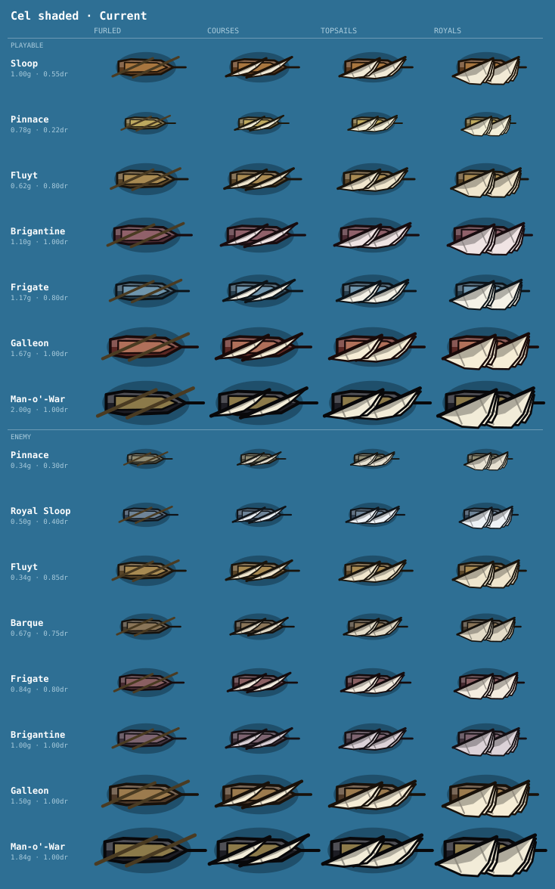

# Pirates2D

A silly little pirate game. You steer; the cannons fire themselves; the wind decides
where you can actually go.

**[Play it in your browser →](https://ljowen.github.io/pirates-2d/)**

TypeScript, PixiJS v8, Vite. No other runtime dependencies — the water, hulls, rigging,
weather and every sound are generated procedurally at runtime.

## Running it

```sh
npm install
npm run dev     # http://localhost:5173
npm run build   # typecheck + production build
npm run bench   # headless balance run: scripted pilot, every hull, 16 seeds
```

## How to play

You have five minutes of sea, a small ship, and everyone else has more guns than you.

- **The wind** decides where you can go. You cannot sail straight into it; keep it on your
  side or behind you. The red pennant at your masthead streams the way it is blowing.
- **The sails**: ↑ makes sail, ↓ takes it in. With every sail furled you stop, and the crew
  mends the ship.
- **The guns** fire by themselves. Turn side-on to an enemy and the broadside goes when she is
  in the arc drawn on the water.
- **The plunder** a beaten ship leaves behind is yours if you sail over it. It is banked as
  doubloons when the voyage ends, even if you sink.
- **Shallow water** is paler. The paler it is, the less water is under you; small ships cross
  bars that stop big ones, which is how you lose a pursuer.

The first few voyages are gentler, and a line under the clock tells you what matters as it
comes up. P pauses and lists the keys.

## The career

Doubloons are spent in port on bigger hulls and permanent refits. Feats (capture a ship, sink
a Galleon, outlast the Man-o'-War) unlock new cards and bigger hulls. Completing a voyage
unlocks notoriety: ten levels of a busier, heavier sea and higher pay.

There are five places to sail, chosen on the port's Charts page. Windward Cays is yours from
the start; the others are earned by the doubloons you have banked over the whole career, and
each remembers your best voyage.

The career is kept in `localStorage`; add `?career=new` to the URL to start over.
`npm run bench` measures the whole arc, from a first voyage to the top of the ladder.

## Controls

| Input | Action |
|---|---|
| ← / → (or LMB / RMB) | Turn |
| ↑ / ↓ | Make / shorten sail — furled, courses (fighting), topsails (full) |
| 1–9 | Pick a card during a level-up draft; buy or pick a hull or a refit in port |
| 0 | Redraw a draft hand, if you have bought a redraw |
| Tab | Change page in port — shipyard, refits, charts, captain's log |
| Enter | Set sail in the hull last taken out; make port when a voyage is over |
| , / . | Lower / raise notoriety in port, once the ladder is open |
| Mouse wheel, + / − | Zoom in / out |
| P | Pause, and show the keys |
| M | Mute |
| C | Sail on into endless mode (offered when you complete a voyage) |
| R | While paused or once the voyage is over: make port, banking what you hauled |

On a touch screen, buttons for steering, sails, zoom and pause appear the first time the
screen is touched.

### Developer keys

Add `?dev` to the address to turn these on, along with the key legend and the **⚙ Tune** button.

| Input | Action |
|---|---|
| T | Turbo (4× time) |
| R | Make port at any time |
| E | Spawn an enemy |
| Q | Spawn a squall to windward |
| ] | Cycle the sea palette (`?style=`) |
| [ | Cycle the hull style (`?hull=`) |
| F1 | Debug overlay — polar plot, velocity vectors, numbers |
| ` | Live tuning panel. The **Career** tab unlocks hulls, refits, feats and notoriety and puts you to sea in any hull in one click; the **World** tab picks the map; **Sounds** plays every sound |

## The fleet

Every hull at every sail state — [`docs/sprite-sheet.svg`](docs/sprite-sheet.svg),
regenerated by `npm run build`.



It is drawn by the game's own `drawHull`, `drawSail` and `solveRig`, painted through an
SVG `Painter` instead of a GPU, so it cannot drift from what you actually sail. Output is
deterministic: unchanged art produces a byte-identical file, and the diff only moves when
the art does.

## Documentation

Design notes, measurements and the reasoning behind the tuning live in [docs/](docs/) —
[ARCHITECTURE](docs/ARCHITECTURE.md), [SAILING](docs/SAILING.md),
[COMBAT](docs/COMBAT.md), [PROGRESSION](docs/PROGRESSION.md),
[TERRAIN](docs/TERRAIN.md), [AUDIO](docs/AUDIO.md), [TUNING](docs/TUNING.md),
[DECISIONS](docs/DECISIONS.md), and the forward plans in
[ROADMAP](docs/ROADMAP.md) and [docs/plans/](docs/plans/).

The one rule that matters: **`sim/` knows nothing about rendering, audio or UI.**
